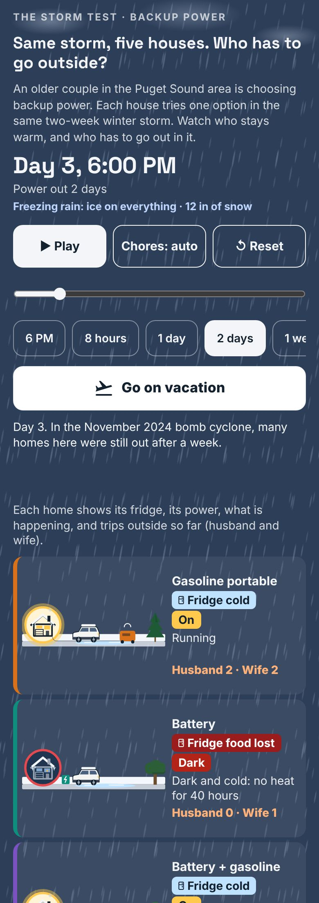

# The storm test: backup power

An interactive page. Five houses ride out the same two-week winter power outage, each with a different backup. The backups are a gasoline portable generator, a battery, a battery with a gasoline generator, a natural-gas portable generator and a natural-gas standby generator. You watch who stays warm, then add up the trips outside, refills and installed cost for a whole outage.

Live at <https://explorables.kphutt.com/backup-power/>.

## Files

- `index.html`: the markup, with no inline scripts or event handlers.
- `app.js`: the simulation and page logic. It fills in the markup with DOM methods, never with HTML strings, and has no `eval`.
- `style.css`: the stylesheet, which also loads the self-hosted fonts.
- `assets/fonts/`: Inter and Space Grotesk, under the SIL Open Font License.

## Numbers

Prices, weights, tank sizes, noise, refill and oil-check intervals, and the fridge rule come from the sources below. Prices were checked on November 11, 2026. Everything else is illustrative, such as household use of about 400 W, 85% of the battery usable, chore times, gas runs and the weather.

Information only, not professional advice. Not affiliated with any company named here.

## Sources

- [Honda EU7000iS specifications](https://powerequipment.honda.com/generators/models/eu7000is) and [owner's manual](https://cdn.powerequipment.honda.com/pe/pdf/manuals/00X31Z376230.pdf)
- [Anker SOLIX F3800 Plus](https://us.ankersolix.com/products/f3800-plus) and its [generator charging cable](https://us.ankersolix.com/products/generator-input-adapter)
- [Westinghouse WGen9500TFc](https://westinghouse.com/products/wgen9500tfc-tri-fuel-with-co-sensor) and the [WGen9500 manual](https://apelectric.com/content/PDF/Westpro/wgen9500_owners_manual.pdf)
- [Mad Dog Electric: Seattle standby installed prices (2026)](https://callmaddog.com/services/whole-house-generator-installation)
- [NailThePrice: Seattle permit records for standby generators (2023 to 2025)](https://nailtheprice.com/electrical/install-whole-house-generator/seattle-wa/)
- [LocalGoingRate: Seattle gas line costs (2026)](https://localgoingrate.com/gas-line-cost-seattle)
- [Generac: check standby oil every 24 hours in long outages](https://www.generac.com/resources/emergency-preparedness/how-to-prepare-a-home-standby-generator-before-a-storm/)
- [FoodSafety.gov / USDA: fridge food is safe for up to 4 hours](https://www.foodsafety.gov/food-safety-charts/food-safety-during-power-outage)
- [GeekWire: gas stations without power in the 2024 bomb cyclone](https://www.geekwire.com/2024/seattle-areas-bomb-cyclone-storm-drives-demand-at-ev-charging-stations-and-gas-pumps/)
